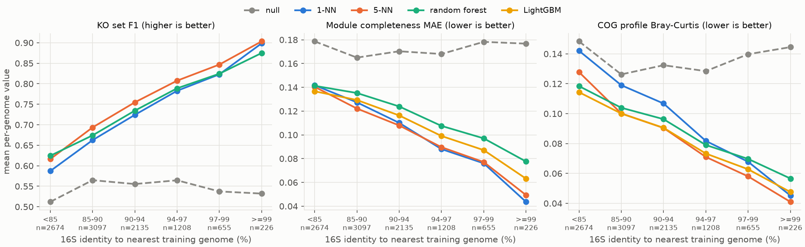
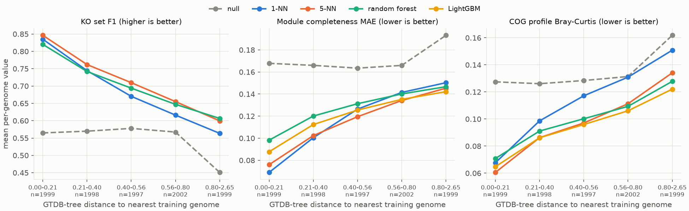
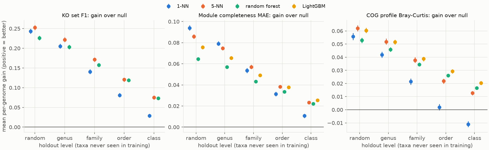
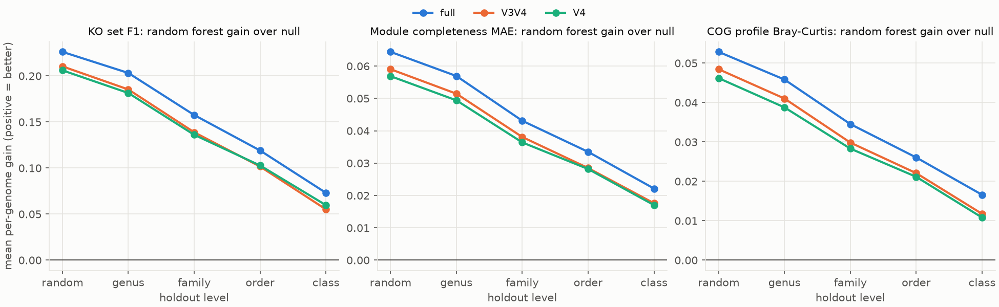

# Aim 1 report: predicting function from 16S

Genomes: 1999. Arms: V3V4, V4, full. Levels: random, genus, family, order, class.

## 16S identity to the nearest training genome (full length)

How close each test genome's 16S is to its most similar training genome, per holdout level (quantiles over genomes). Stricter holdouts push test genomes further from the training data.

| level | count | 10% | 50% | 90% |
|---|---|---|---|---|
| class | 1999.000 | 0.797 | 0.850 | 0.912 |
| family | 1999.000 | 0.829 | 0.886 | 0.938 |
| genus | 1999.000 | 0.840 | 0.923 | 0.970 |
| order | 1999.000 | 0.807 | 0.865 | 0.925 |
| random | 1999.000 | 0.849 | 0.940 | 0.991 |

## Accuracy vs 16S identity (full length, all levels pooled)

> **Figure 1. Accuracy against 16S similarity to the closest training genome.** Every test genome is placed in a bin by the full-length 16S identity to its most similar genome in the training folds (all holdout levels pooled, so each genome counts once per level; n under each bin). Each point is the mean per-genome score in that bin.
>
> Panels: **KO set F1** = overlap between the predicted and the true set of KEGG orthologs of a genome (1 = perfect); **module completeness MAE** = mean absolute error of predicted KEGG module completeness (0-1 scale; 0 = perfect); **COG profile Bray-Curtis** = dissimilarity between predicted and true COG-category composition (0 = identical).
>
> Models: **null** = training-set prevalence or mean, ignores the 16S (dashed grey); **1-NN / 5-NN** = copy the function profile of the 1 or 5 training genomes with the most similar 16S; **random forest / LightGBM** = learned from aligned 16S positions (LightGBM is fitted for modules and COGs only).
>
> **How to read it:** the distance between a model line and the dashed null line is what the 16S adds. Lines that slope towards perfect (up for F1, down for the errors) mean predictions are only as good as the nearest relative in the reference.
>
> **Here:** the best KO F1 goes from 0.62 in the lowest-identity bin (<85 %) to 0.90 at >=99 %, while the null stays between 0.51 and 0.56.

## Accuracy vs GTDB-tree distance (full length)

Spearman correlation between 16S identity and tree distance to the nearest training genome: -0.788.

> **Figure 4. The same accuracy curves against evolutionary distance on the GTDB tree.** The x axis is the patristic distance (sum of branch lengths, substitutions per site on the GTDB marker-protein tree) from each test genome to its closest training genome, cut into five equal-count bins (quintiles). Archaea and bacteria sit on separate trees, so each genome's nearest relative is searched within its domain.
>
> Panels: **KO set F1** = overlap between the predicted and the true set of KEGG orthologs of a genome (1 = perfect); **module completeness MAE** = mean absolute error of predicted KEGG module completeness (0-1 scale; 0 = perfect); **COG profile Bray-Curtis** = dissimilarity between predicted and true COG-category composition (0 = identical).
>
> Models: **null** = training-set prevalence or mean, ignores the 16S (dashed grey); **1-NN / 5-NN** = copy the function profile of the 1 or 5 training genomes with the most similar 16S; **random forest / LightGBM** = learned from aligned 16S positions (LightGBM is fitted for modules and COGs only).
>
> **How to read it:** if this figure looks like figure 1 mirrored, 16S identity is mostly a proxy for phylogenetic distance. Spearman correlation of the two distances: -0.79.
>
> **Here:** the best KO F1 falls from 0.85 (closest quintile) to 0.61 (most distant).

## Gain over the null model by holdout level (full length)

> **Figure 2. Gain over the null model, by how distant the test genomes are from the training data.** Each holdout level keeps whole taxa out of training: *random* = ordinary 5-fold split; *genus* ... *class* = every genome of the test genus (or family, order, class) is unseen during training. Points are mean per-genome gain over the null (positive = better than ignoring the 16S); bars are 95 % bootstrap CIs.
>
> Panels: **KO set F1** = overlap between the predicted and the true set of KEGG orthologs of a genome (1 = perfect); **module completeness MAE** = mean absolute error of predicted KEGG module completeness (0-1 scale; 0 = perfect); **COG profile Bray-Curtis** = dissimilarity between predicted and true COG-category composition (0 = identical).
>
> Models: **null** = training-set prevalence or mean, ignores the 16S (dashed grey); **1-NN / 5-NN** = copy the function profile of the 1 or 5 training genomes with the most similar 16S; **random forest / LightGBM** = learned from aligned 16S positions (LightGBM is fitted for modules and COGs only).
>
> **How to read it:** the left-to-right decline shows how fast 16S-based prediction degrades for organisms with no close relative in the reference. A point at 0 means no better than the null.
>
> **Here:** random forest KO F1 gain is 0.226 on a random split and 0.073 when whole classes are held out.

| target_type | metric | model | level | mean_gain | ci_lo | ci_hi | n |
|---|---|---|---|---|---|---|---|
| ko | f1 | M1_knn1 | random | 0.243 | 0.236 | 0.249 | 1999 |
| ko | f1 | M1_knn1 | genus | 0.205 | 0.199 | 0.211 | 1999 |
| ko | f1 | M1_knn1 | family | 0.141 | 0.135 | 0.147 | 1999 |
| ko | f1 | M1_knn1 | order | 0.081 | 0.076 | 0.087 | 1999 |
| ko | f1 | M1_knn1 | class | 0.029 | 0.024 | 0.034 | 1999 |
| ko | f1 | M1_knn5 | random | 0.253 | 0.246 | 0.258 | 1999 |
| ko | f1 | M1_knn5 | genus | 0.222 | 0.216 | 0.228 | 1999 |
| ko | f1 | M1_knn5 | family | 0.172 | 0.166 | 0.177 | 1999 |
| ko | f1 | M1_knn5 | order | 0.121 | 0.115 | 0.126 | 1999 |
| ko | f1 | M1_knn5 | class | 0.075 | 0.070 | 0.080 | 1999 |
| ko | f1 | M3_rf | random | 0.226 | 0.220 | 0.232 | 1999 |
| ko | f1 | M3_rf | genus | 0.203 | 0.198 | 0.209 | 1999 |
| ko | f1 | M3_rf | family | 0.158 | 0.152 | 0.163 | 1999 |
| ko | f1 | M3_rf | order | 0.119 | 0.115 | 0.124 | 1999 |
| ko | f1 | M3_rf | class | 0.073 | 0.069 | 0.078 | 1999 |
| module | mae | M1_knn1 | random | 0.094 | 0.092 | 0.096 | 1999 |
| module | mae | M1_knn1 | genus | 0.079 | 0.077 | 0.081 | 1999 |
| module | mae | M1_knn1 | family | 0.054 | 0.051 | 0.056 | 1999 |
| module | mae | M1_knn1 | order | 0.031 | 0.029 | 0.034 | 1999 |
| module | mae | M1_knn1 | class | 0.011 | 0.009 | 0.013 | 1999 |
| module | mae | M1_knn5 | random | 0.086 | 0.084 | 0.088 | 1999 |
| module | mae | M1_knn5 | genus | 0.075 | 0.073 | 0.076 | 1999 |
| module | mae | M1_knn5 | family | 0.057 | 0.055 | 0.059 | 1999 |
| module | mae | M1_knn5 | order | 0.038 | 0.037 | 0.040 | 1999 |
| module | mae | M1_knn5 | class | 0.023 | 0.022 | 0.025 | 1999 |
| module | mae | M3_rf | random | 0.064 | 0.063 | 0.066 | 1999 |
| module | mae | M3_rf | genus | 0.057 | 0.055 | 0.059 | 1999 |
| module | mae | M3_rf | family | 0.043 | 0.042 | 0.045 | 1999 |
| module | mae | M3_rf | order | 0.034 | 0.032 | 0.035 | 1999 |
| module | mae | M3_rf | class | 0.022 | 0.021 | 0.023 | 1999 |
| module | mae | M4_lgbm | random | 0.076 | 0.074 | 0.077 | 1999 |
| module | mae | M4_lgbm | genus | 0.066 | 0.064 | 0.067 | 1999 |
| module | mae | M4_lgbm | family | 0.049 | 0.048 | 0.051 | 1999 |
| module | mae | M4_lgbm | order | 0.038 | 0.036 | 0.039 | 1999 |
| module | mae | M4_lgbm | class | 0.025 | 0.024 | 0.027 | 1999 |
| cog | bray_curtis | M1_knn1 | random | 0.056 | 0.053 | 0.058 | 1999 |
| cog | bray_curtis | M1_knn1 | genus | 0.042 | 0.040 | 0.044 | 1999 |
| cog | bray_curtis | M1_knn1 | family | 0.021 | 0.019 | 0.024 | 1999 |
| cog | bray_curtis | M1_knn1 | order | 0.002 | -0.000 | 0.004 | 1999 |
| cog | bray_curtis | M1_knn1 | class | -0.011 | -0.013 | -0.009 | 1999 |
| cog | bray_curtis | M1_knn5 | random | 0.062 | 0.060 | 0.064 | 1999 |
| cog | bray_curtis | M1_knn5 | genus | 0.052 | 0.050 | 0.054 | 1999 |
| cog | bray_curtis | M1_knn5 | family | 0.038 | 0.036 | 0.040 | 1999 |
| cog | bray_curtis | M1_knn5 | order | 0.022 | 0.020 | 0.024 | 1999 |
| cog | bray_curtis | M1_knn5 | class | 0.013 | 0.011 | 0.014 | 1999 |
| cog | bray_curtis | M3_rf | random | 0.053 | 0.051 | 0.055 | 1999 |
| cog | bray_curtis | M3_rf | genus | 0.046 | 0.044 | 0.048 | 1999 |
| cog | bray_curtis | M3_rf | family | 0.035 | 0.033 | 0.036 | 1999 |
| cog | bray_curtis | M3_rf | order | 0.026 | 0.025 | 0.027 | 1999 |
| cog | bray_curtis | M3_rf | class | 0.017 | 0.015 | 0.018 | 1999 |
| cog | bray_curtis | M4_lgbm | random | 0.060 | 0.058 | 0.062 | 1999 |
| cog | bray_curtis | M4_lgbm | genus | 0.051 | 0.050 | 0.053 | 1999 |
| cog | bray_curtis | M4_lgbm | family | 0.039 | 0.037 | 0.040 | 1999 |
| cog | bray_curtis | M4_lgbm | order | 0.029 | 0.028 | 0.031 | 1999 |
| cog | bray_curtis | M4_lgbm | class | 0.020 | 0.019 | 0.022 | 1999 |

## Learned models vs k-NN (paired per genome; positive = learned model better)

Same genomes, same folds: mean per-genome difference between a learned model and a k-NN model, with 95 % bootstrap CI and Wilcoxon signed-rank p. Positive means the learned model is better (errors are sign-flipped). This tests whether learning from individual 16S positions adds anything over copying the closest relatives.

| arm | level | metric | comparison | n | mean_diff | ci_lo | ci_hi | wilcoxon_p |
|---|---|---|---|---|---|---|---|---|
| V3V4 | class | bray_curtis | M3_rf - M1_knn1 | 1917 | 0.035 | 0.032 | 0.037 | 0.000 |
| V3V4 | class | f1 | M3_rf - M1_knn1 | 1917 | 0.054 | 0.051 | 0.058 | 0.000 |
| V3V4 | class | mae | M3_rf - M1_knn1 | 1917 | 0.017 | 0.015 | 0.019 | 0.000 |
| V3V4 | family | bray_curtis | M3_rf - M1_knn1 | 1917 | 0.015 | 0.013 | 0.018 | 0.000 |
| V3V4 | family | f1 | M3_rf - M1_knn1 | 1917 | 0.023 | 0.018 | 0.028 | 0.000 |
| V3V4 | family | mae | M3_rf - M1_knn1 | 1917 | -0.006 | -0.009 | -0.004 | 0.000 |
| V3V4 | genus | bray_curtis | M3_rf - M1_knn1 | 1917 | 0.003 | 0.001 | 0.005 | 0.136 |
| V3V4 | genus | f1 | M3_rf - M1_knn1 | 1917 | -0.005 | -0.009 | -0.002 | 0.006 |
| V3V4 | genus | mae | M3_rf - M1_knn1 | 1917 | -0.022 | -0.024 | -0.021 | 0.000 |
| V3V4 | order | bray_curtis | M3_rf - M1_knn1 | 1917 | 0.027 | 0.025 | 0.029 | 0.000 |
| V3V4 | order | f1 | M3_rf - M1_knn1 | 1917 | 0.042 | 0.038 | 0.046 | 0.000 |
| V3V4 | order | mae | M3_rf - M1_knn1 | 1917 | 0.006 | 0.004 | 0.008 | 0.000 |
| V3V4 | random | bray_curtis | M3_rf - M1_knn1 | 1917 | -0.004 | -0.005 | -0.002 | 0.000 |
| V3V4 | random | f1 | M3_rf - M1_knn1 | 1917 | -0.018 | -0.021 | -0.015 | 0.000 |
| V3V4 | random | mae | M3_rf - M1_knn1 | 1917 | -0.030 | -0.031 | -0.028 | 0.000 |
| V4 | class | bray_curtis | M3_rf - M1_knn1 | 1961 | 0.033 | 0.031 | 0.035 | 0.000 |
| V4 | class | f1 | M3_rf - M1_knn1 | 1961 | 0.058 | 0.054 | 0.061 | 0.000 |
| V4 | class | mae | M3_rf - M1_knn1 | 1961 | 0.017 | 0.015 | 0.019 | 0.000 |
| V4 | family | bray_curtis | M3_rf - M1_knn1 | 1961 | 0.017 | 0.015 | 0.019 | 0.000 |
| V4 | family | f1 | M3_rf - M1_knn1 | 1961 | 0.025 | 0.021 | 0.030 | 0.000 |
| V4 | family | mae | M3_rf - M1_knn1 | 1961 | -0.005 | -0.007 | -0.003 | 0.000 |
| V4 | genus | bray_curtis | M3_rf - M1_knn1 | 1961 | 0.003 | 0.001 | 0.004 | 0.168 |
| V4 | genus | f1 | M3_rf - M1_knn1 | 1961 | -0.007 | -0.010 | -0.003 | 0.000 |
| V4 | genus | mae | M3_rf - M1_knn1 | 1961 | -0.023 | -0.025 | -0.021 | 0.000 |
| V4 | order | bray_curtis | M3_rf - M1_knn1 | 1961 | 0.029 | 0.027 | 0.031 | 0.000 |
| V4 | order | f1 | M3_rf - M1_knn1 | 1961 | 0.048 | 0.044 | 0.052 | 0.000 |
| V4 | order | mae | M3_rf - M1_knn1 | 1961 | 0.007 | 0.005 | 0.009 | 0.000 |
| V4 | random | bray_curtis | M3_rf - M1_knn1 | 1961 | -0.005 | -0.007 | -0.003 | 0.000 |
| V4 | random | f1 | M3_rf - M1_knn1 | 1961 | -0.021 | -0.025 | -0.017 | 0.000 |
| V4 | random | mae | M3_rf - M1_knn1 | 1961 | -0.031 | -0.032 | -0.029 | 0.000 |
| full | class | bray_curtis | M3_rf - M1_knn1 | 1999 | 0.028 | 0.026 | 0.030 | 0.000 |
| full | class | f1 | M3_rf - M1_knn1 | 1999 | 0.044 | 0.041 | 0.047 | 0.000 |
| full | class | mae | M3_rf - M1_knn1 | 1999 | 0.011 | 0.010 | 0.013 | 0.000 |
| full | family | bray_curtis | M3_rf - M1_knn1 | 1999 | 0.013 | 0.011 | 0.015 | 0.000 |
| full | family | f1 | M3_rf - M1_knn1 | 1999 | 0.017 | 0.013 | 0.020 | 0.000 |
| full | family | mae | M3_rf - M1_knn1 | 1999 | -0.011 | -0.012 | -0.009 | 0.000 |
| full | genus | bray_curtis | M3_rf - M1_knn1 | 1999 | 0.004 | 0.002 | 0.006 | 0.001 |
| full | genus | f1 | M3_rf - M1_knn1 | 1999 | -0.002 | -0.005 | 0.001 | 0.391 |
| full | genus | mae | M3_rf - M1_knn1 | 1999 | -0.022 | -0.024 | -0.021 | 0.000 |
| full | order | bray_curtis | M3_rf - M1_knn1 | 1999 | 0.024 | 0.022 | 0.026 | 0.000 |
| full | order | f1 | M3_rf - M1_knn1 | 1999 | 0.038 | 0.035 | 0.042 | 0.000 |
| full | order | mae | M3_rf - M1_knn1 | 1999 | 0.002 | 0.001 | 0.004 | 0.003 |
| full | random | bray_curtis | M3_rf - M1_knn1 | 1999 | -0.003 | -0.004 | -0.001 | 0.000 |
| full | random | f1 | M3_rf - M1_knn1 | 1999 | -0.017 | -0.020 | -0.014 | 0.000 |
| full | random | mae | M3_rf - M1_knn1 | 1999 | -0.030 | -0.031 | -0.028 | 0.000 |
| V3V4 | class | bray_curtis | M3_rf - M1_knn5 | 1917 | 0.005 | 0.004 | 0.007 | 0.000 |
| V3V4 | class | f1 | M3_rf - M1_knn5 | 1917 | 0.003 | 0.000 | 0.005 | 0.374 |
| V3V4 | class | mae | M3_rf - M1_knn5 | 1917 | 0.001 | -0.000 | 0.002 | 0.290 |
| V3V4 | family | bray_curtis | M3_rf - M1_knn5 | 1917 | -0.002 | -0.003 | -0.000 | 0.001 |
| V3V4 | family | f1 | M3_rf - M1_knn5 | 1917 | -0.013 | -0.016 | -0.011 | 0.000 |
| V3V4 | family | mae | M3_rf - M1_knn5 | 1917 | -0.012 | -0.013 | -0.011 | 0.000 |
| V3V4 | genus | bray_curtis | M3_rf - M1_knn5 | 1917 | -0.007 | -0.008 | -0.006 | 0.000 |
| V3V4 | genus | f1 | M3_rf - M1_knn5 | 1917 | -0.022 | -0.025 | -0.019 | 0.000 |
| V3V4 | genus | mae | M3_rf - M1_knn5 | 1917 | -0.018 | -0.019 | -0.017 | 0.000 |
| V3V4 | order | bray_curtis | M3_rf - M1_knn5 | 1917 | 0.005 | 0.003 | 0.006 | 0.000 |
| V3V4 | order | f1 | M3_rf - M1_knn5 | 1917 | 0.003 | 0.000 | 0.006 | 0.316 |
| V3V4 | order | mae | M3_rf - M1_knn5 | 1917 | -0.003 | -0.004 | -0.002 | 0.000 |
| V3V4 | random | bray_curtis | M3_rf - M1_knn5 | 1917 | -0.011 | -0.012 | -0.009 | 0.000 |
| V3V4 | random | f1 | M3_rf - M1_knn5 | 1917 | -0.030 | -0.033 | -0.028 | 0.000 |
| V3V4 | random | mae | M3_rf - M1_knn5 | 1917 | -0.023 | -0.024 | -0.022 | 0.000 |
| V4 | class | bray_curtis | M3_rf - M1_knn5 | 1961 | 0.005 | 0.004 | 0.007 | 0.000 |
| V4 | class | f1 | M3_rf - M1_knn5 | 1961 | 0.010 | 0.007 | 0.012 | 0.000 |
| V4 | class | mae | M3_rf - M1_knn5 | 1961 | 0.002 | 0.001 | 0.003 | 0.448 |
| V4 | family | bray_curtis | M3_rf - M1_knn5 | 1961 | -0.002 | -0.004 | -0.001 | 0.000 |
| V4 | family | f1 | M3_rf - M1_knn5 | 1961 | -0.012 | -0.015 | -0.009 | 0.000 |
| V4 | family | mae | M3_rf - M1_knn5 | 1961 | -0.012 | -0.013 | -0.011 | 0.000 |
| V4 | genus | bray_curtis | M3_rf - M1_knn5 | 1961 | -0.008 | -0.009 | -0.006 | 0.000 |
| V4 | genus | f1 | M3_rf - M1_knn5 | 1961 | -0.023 | -0.026 | -0.020 | 0.000 |
| V4 | genus | mae | M3_rf - M1_knn5 | 1961 | -0.018 | -0.019 | -0.018 | 0.000 |
| V4 | order | bray_curtis | M3_rf - M1_knn5 | 1961 | 0.005 | 0.004 | 0.006 | 0.000 |
| V4 | order | f1 | M3_rf - M1_knn5 | 1961 | 0.005 | 0.002 | 0.008 | 0.006 |
| V4 | order | mae | M3_rf - M1_knn5 | 1961 | -0.002 | -0.003 | -0.001 | 0.000 |
| V4 | random | bray_curtis | M3_rf - M1_knn5 | 1961 | -0.012 | -0.013 | -0.010 | 0.000 |
| V4 | random | f1 | M3_rf - M1_knn5 | 1961 | -0.033 | -0.035 | -0.030 | 0.000 |
| V4 | random | mae | M3_rf - M1_knn5 | 1961 | -0.024 | -0.025 | -0.023 | 0.000 |
| full | class | bray_curtis | M3_rf - M1_knn5 | 1999 | 0.004 | 0.002 | 0.005 | 0.026 |
| full | class | f1 | M3_rf - M1_knn5 | 1999 | -0.002 | -0.005 | 0.000 | 0.000 |
| full | class | mae | M3_rf - M1_knn5 | 1999 | -0.001 | -0.002 | -0.000 | 0.000 |
| full | family | bray_curtis | M3_rf - M1_knn5 | 1999 | -0.003 | -0.005 | -0.002 | 0.000 |
| full | family | f1 | M3_rf - M1_knn5 | 1999 | -0.014 | -0.016 | -0.011 | 0.000 |
| full | family | mae | M3_rf - M1_knn5 | 1999 | -0.014 | -0.015 | -0.013 | 0.000 |
| full | genus | bray_curtis | M3_rf - M1_knn5 | 1999 | -0.006 | -0.007 | -0.005 | 0.000 |
| full | genus | f1 | M3_rf - M1_knn5 | 1999 | -0.018 | -0.021 | -0.016 | 0.000 |
| full | genus | mae | M3_rf - M1_knn5 | 1999 | -0.018 | -0.019 | -0.017 | 0.000 |
| full | order | bray_curtis | M3_rf - M1_knn5 | 1999 | 0.004 | 0.003 | 0.006 | 0.000 |
| full | order | f1 | M3_rf - M1_knn5 | 1999 | -0.002 | -0.004 | 0.001 | 0.003 |
| full | order | mae | M3_rf - M1_knn5 | 1999 | -0.005 | -0.006 | -0.004 | 0.000 |
| full | random | bray_curtis | M3_rf - M1_knn5 | 1999 | -0.009 | -0.010 | -0.008 | 0.000 |
| full | random | f1 | M3_rf - M1_knn5 | 1999 | -0.026 | -0.029 | -0.024 | 0.000 |
| full | random | mae | M3_rf - M1_knn5 | 1999 | -0.021 | -0.022 | -0.021 | 0.000 |
| V3V4 | class | bray_curtis | M4_lgbm - M1_knn5 | 1917 | 0.007 | 0.005 | 0.008 | 0.000 |
| V3V4 | class | mae | M4_lgbm - M1_knn5 | 1917 | 0.002 | 0.001 | 0.003 | 0.593 |
| V3V4 | family | bray_curtis | M4_lgbm - M1_knn5 | 1917 | 0.001 | -0.000 | 0.002 | 0.747 |
| V3V4 | family | mae | M4_lgbm - M1_knn5 | 1917 | -0.007 | -0.008 | -0.006 | 0.000 |
| V3V4 | genus | bray_curtis | M4_lgbm - M1_knn5 | 1917 | -0.002 | -0.003 | -0.001 | 0.000 |
| V3V4 | genus | mae | M4_lgbm - M1_knn5 | 1917 | -0.010 | -0.011 | -0.009 | 0.000 |
| V3V4 | order | bray_curtis | M4_lgbm - M1_knn5 | 1917 | 0.007 | 0.005 | 0.008 | 0.000 |
| V3V4 | order | mae | M4_lgbm - M1_knn5 | 1917 | 0.000 | -0.001 | 0.001 | 0.007 |
| V3V4 | random | bray_curtis | M4_lgbm - M1_knn5 | 1917 | -0.004 | -0.005 | -0.002 | 0.000 |
| V3V4 | random | mae | M4_lgbm - M1_knn5 | 1917 | -0.012 | -0.013 | -0.011 | 0.000 |
| V4 | class | bray_curtis | M4_lgbm - M1_knn5 | 1961 | 0.005 | 0.004 | 0.006 | 0.000 |
| V4 | class | mae | M4_lgbm - M1_knn5 | 1961 | 0.002 | 0.001 | 0.003 | 0.027 |
| V4 | family | bray_curtis | M4_lgbm - M1_knn5 | 1961 | 0.000 | -0.001 | 0.002 | 0.297 |
| V4 | family | mae | M4_lgbm - M1_knn5 | 1961 | -0.007 | -0.008 | -0.006 | 0.000 |
| V4 | genus | bray_curtis | M4_lgbm - M1_knn5 | 1961 | -0.002 | -0.004 | -0.001 | 0.000 |
| V4 | genus | mae | M4_lgbm - M1_knn5 | 1961 | -0.011 | -0.011 | -0.010 | 0.000 |
| V4 | order | bray_curtis | M4_lgbm - M1_knn5 | 1961 | 0.006 | 0.005 | 0.008 | 0.000 |
| V4 | order | mae | M4_lgbm - M1_knn5 | 1961 | 0.000 | -0.001 | 0.001 | 0.014 |
| V4 | random | bray_curtis | M4_lgbm - M1_knn5 | 1961 | -0.005 | -0.006 | -0.004 | 0.000 |
| V4 | random | mae | M4_lgbm - M1_knn5 | 1961 | -0.013 | -0.014 | -0.012 | 0.000 |
| full | class | bray_curtis | M4_lgbm - M1_knn5 | 1999 | 0.008 | 0.006 | 0.009 | 0.000 |
| full | class | mae | M4_lgbm - M1_knn5 | 1999 | 0.002 | 0.001 | 0.003 | 0.019 |
| full | family | bray_curtis | M4_lgbm - M1_knn5 | 1999 | 0.001 | -0.000 | 0.002 | 0.153 |
| full | family | mae | M4_lgbm - M1_knn5 | 1999 | -0.008 | -0.009 | -0.007 | 0.000 |
| full | genus | bray_curtis | M4_lgbm - M1_knn5 | 1999 | -0.000 | -0.001 | 0.001 | 0.000 |
| full | genus | mae | M4_lgbm - M1_knn5 | 1999 | -0.009 | -0.010 | -0.008 | 0.000 |
| full | order | bray_curtis | M4_lgbm - M1_knn5 | 1999 | 0.007 | 0.006 | 0.009 | 0.000 |
| full | order | mae | M4_lgbm - M1_knn5 | 1999 | -0.001 | -0.002 | 0.001 | 0.000 |
| full | random | bray_curtis | M4_lgbm - M1_knn5 | 1999 | -0.002 | -0.003 | -0.001 | 0.000 |
| full | random | mae | M4_lgbm - M1_knn5 | 1999 | -0.010 | -0.011 | -0.010 | 0.000 |

## Amplicon arms (random forest gain over null)

> **Figure 3. Full-length 16S against in-silico amplicons.** The random forest is trained and tested on the full gene (*full*) or only on the region a primer pair would amplify (in-silico PCR with the primers in `primers.tsv`). Genomes whose 16S does not amplify are left out of that arm. Points are mean gain over the null, per holdout level.
>
> Panels: **KO set F1** = overlap between the predicted and the true set of KEGG orthologs of a genome (1 = perfect); **module completeness MAE** = mean absolute error of predicted KEGG module completeness (0-1 scale; 0 = perfect); **COG profile Bray-Curtis** = dissimilarity between predicted and true COG-category composition (0 = identical).
>
> **How to read it:** the gap between the *full* line and an amplicon line is the information lost by sequencing only that region.
>
> **Here (KO F1 gain):** random: full 0.226, V3V4 0.210, V4 0.206; class: full 0.073, V3V4 0.055, V4 0.060.

| target_type | metric | arm | level | mean_gain |
|---|---|---|---|---|
| ko | f1 | full | random | 0.226 |
| ko | f1 | full | genus | 0.203 |
| ko | f1 | full | family | 0.158 |
| ko | f1 | full | order | 0.119 |
| ko | f1 | full | class | 0.073 |
| ko | f1 | V3V4 | random | 0.210 |
| ko | f1 | V3V4 | genus | 0.185 |
| ko | f1 | V3V4 | family | 0.139 |
| ko | f1 | V3V4 | order | 0.102 |
| ko | f1 | V3V4 | class | 0.055 |
| ko | f1 | V4 | random | 0.206 |
| ko | f1 | V4 | genus | 0.181 |
| ko | f1 | V4 | family | 0.136 |
| ko | f1 | V4 | order | 0.103 |
| ko | f1 | V4 | class | 0.060 |
| module | mae | full | random | 0.064 |
| module | mae | full | genus | 0.057 |
| module | mae | full | family | 0.043 |
| module | mae | full | order | 0.034 |
| module | mae | full | class | 0.022 |
| module | mae | V3V4 | random | 0.059 |
| module | mae | V3V4 | genus | 0.051 |
| module | mae | V3V4 | family | 0.038 |
| module | mae | V3V4 | order | 0.029 |
| module | mae | V3V4 | class | 0.018 |
| module | mae | V4 | random | 0.057 |
| module | mae | V4 | genus | 0.049 |
| module | mae | V4 | family | 0.036 |
| module | mae | V4 | order | 0.028 |
| module | mae | V4 | class | 0.017 |
| cog | bray_curtis | full | random | 0.053 |
| cog | bray_curtis | full | genus | 0.046 |
| cog | bray_curtis | full | family | 0.035 |
| cog | bray_curtis | full | order | 0.026 |
| cog | bray_curtis | full | class | 0.017 |
| cog | bray_curtis | V3V4 | random | 0.049 |
| cog | bray_curtis | V3V4 | genus | 0.041 |
| cog | bray_curtis | V3V4 | family | 0.030 |
| cog | bray_curtis | V3V4 | order | 0.022 |
| cog | bray_curtis | V3V4 | class | 0.012 |
| cog | bray_curtis | V4 | random | 0.046 |
| cog | bray_curtis | V4 | genus | 0.039 |
| cog | bray_curtis | V4 | family | 0.028 |
| cog | bray_curtis | V4 | order | 0.021 |
| cog | bray_curtis | V4 | class | 0.011 |

## KO prediction: median per-KO AUROC (pooled over folds)

For each KO, how well the predicted score ranks genomes that have it above genomes that lack it (0.5 = chance, 1 = perfect); median over KOs. The null predicts one constant per fold, so its pooled AUROC can fall below 0.5 when held-out clades differ from the training prevalence; it is shown only for reference.

| arm | level | M0_null | M1_knn1 | M1_knn5 | M3_rf |
|---|---|---|---|---|---|
| V3V4 | class | 0.381 | 0.539 | 0.607 | 0.674 |
| V3V4 | family | 0.437 | 0.675 | 0.783 | 0.834 |
| V3V4 | genus | 0.456 | 0.759 | 0.852 | 0.884 |
| V3V4 | order | 0.401 | 0.609 | 0.704 | 0.777 |
| V3V4 | random | 0.466 | 0.801 | 0.883 | 0.906 |
| V4 | class | 0.381 | 0.538 | 0.596 | 0.660 |
| V4 | family | 0.435 | 0.667 | 0.777 | 0.828 |
| V4 | genus | 0.457 | 0.752 | 0.846 | 0.879 |
| V4 | order | 0.400 | 0.604 | 0.700 | 0.772 |
| V4 | random | 0.468 | 0.798 | 0.879 | 0.901 |
| full | class | 0.383 | 0.552 | 0.633 | 0.702 |
| full | family | 0.437 | 0.689 | 0.797 | 0.847 |
| full | genus | 0.458 | 0.768 | 0.860 | 0.891 |
| full | order | 0.399 | 0.613 | 0.718 | 0.792 |
| full | random | 0.467 | 0.810 | 0.889 | 0.911 |

## PICRUSt2 (M2) out of the box: external reference only

Its reference genomes overlap the test genomes, so these scores are optimistic (DESIGN §4.1). Our models shown at the random holdout level, the closest comparison. PICRUSt2 places each 16S in its own reference tree and predicts KO copy numbers by hidden-state prediction; a KO counts as predicted when its copy number is >= 1. Rows split the genomes by whether the genome itself is in PICRUSt2's reference (same GTDB accession; leakage). NSTI = tree distance to the closest reference genome. Full head-to-head: [PICRUSt2 comparison](../picrust2_comparison/picrust2_comparison.md).

| model | f1 | jaccard | nsti | n_genomes |
|---|---|---|---|---|
| M0_null | 0.549 | 0.385 | nan | 1999.000 |
| M1_knn1 | 0.792 | 0.669 | nan | 1999.000 |
| M1_knn5 | 0.802 | 0.682 | nan | 1999.000 |
| M2_picrust2 (self in reference) | 0.937 | 0.887 | 0.024 | 794.000 |
| M2_picrust2 (self not in reference) | 0.783 | 0.671 | 0.270 | 1205.000 |
| M3_rf | 0.775 | 0.644 | nan | 1999.000 |

Tables behind every figure are in the `fig*_data.tsv` files next to this report.
