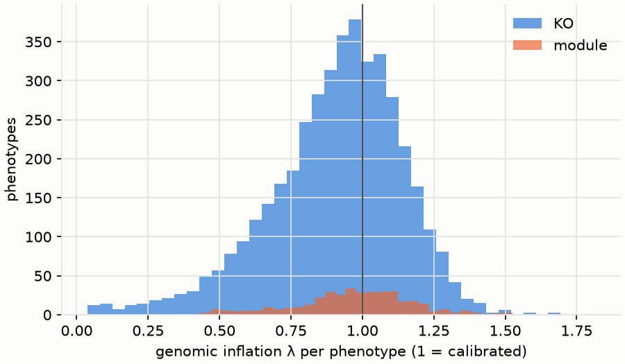
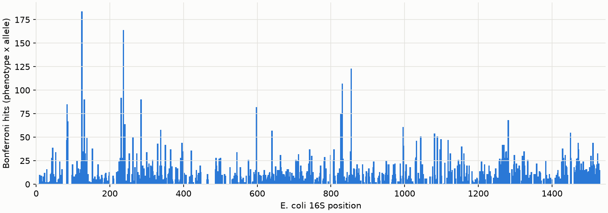

# Aim 2 report: 16S alleles associated with function beyond phylogeny

Genomes: 1795 (bacteria). Variants tested: 3252 (3106 unique patterns; Bonferroni threshold p < 1.61e-05). Phenotypes: 4233 KOs, 383 modules.

## Calibration

| kind | count | 10% | 50% | 90% |
|---|---|---|---|---|
| KO | 4.23e+03 | 0.595 | 0.936 | 1.18 |
| module | 383 | 0.676 | 0.986 | 1.2 |

## Significant associations

Bonferroni hits (phenotype × allele): **11591** across 2518 phenotypes and 2272 alleles. BH-FDR < 0.05 (unflagged): 20801. Tests flagged by pyseer (`notes`, e.g. bad-chisq / high-bse) are never hits: 10.7% of all tests.

Alleles among hits that arose more than once on the tree (Fitch changes > 1): **2272 of 2272**. Only these can support association beyond phylogeny.

Top 30 hits:

| phenotype | variant | ecoli_pos | state | af | beta | p | fitch_changes |
|---|---|---|---|---|---|---|---|
| K03170 | 782_22587_A | 782 | A | 0.99 | -0.645 | 1.44e-95 | 5 |
| K03170 | 950_29674_T | 950 | T | 0.975 | -0.485 | 1.38e-87 | 17 |
| K03170 | 950_29674_C | 950 | C | 0.0245 | 0.461 | 4.76e-83 | 18 |
| K03170 | 712_21977_G | 712 | G | 0.0173 | 0.48 | 4.98e-73 | 14 |
| K03170 | 1506_43228_C | 1506 | C | 0.0273 | 0.37 | 8.03e-51 | 16 |
| K03170 | 1334_41456_C | 1334 | C | 0.0189 | -0.369 | 1.59e-50 | 14 |
| K03170 | 1303_40938_G | 1303 | G | 0.0189 | -0.369 | 1.59e-50 | 14 |
| K03170 | 970_31145_C | 970 | C | 0.921 | -0.299 | 9.97e-48 | 27 |
| K03170 | 970_31145_A | 970 | A | 0.0786 | 0.288 | 3.77e-46 | 28 |
| K03170 | 1334_41456_G | 1334 | G | 0.979 | 0.306 | 8.98e-42 | 17 |
| K03170 | 1099_35138_T | 1099 | T | 0.0373 | 0.291 | 2.05e-38 | 26 |
| K03170 | 718_21993_G | 718 | G | 0.0568 | 0.222 | 7.71e-37 | 37 |
| K01915 | 1099_35138_C | 1099 | C | 0.0134 | -0.535 | 4.66e-36 | 14 |
| K03170 | 1303_40938_C | 1303 | C | 0.979 | 0.256 | 2.53e-35 | 18 |
| K05837 | 782_22587_A | 782 | A | 0.99 | 0.666 | 3.38e-32 | 5 |
| K07082 | 1352_41493_T | 1352 | T | 0.01 | -0.518 | 2.8e-31 | 11 |
| K03170 | 623_16282_C | 623 | C | 0.982 | -0.223 | 5.73e-31 | 22 |
| K03170 | 617_15972_G | 617 | G | 0.981 | -0.22 | 1.4e-30 | 26 |
| K18955 | 911_28428_T | 911 | T | 0.988 | -0.263 | 1.4e-29 | 6 |
| K07082 | 1370_41542_G | 1370 | G | 0.943 | 0.389 | 2.43e-29 | 21 |
| K03170 | 684_21776_T | 684 | T | 0.952 | -0.205 | 1.28e-28 | 27 |
| K12961 | 1416_42569_T | 1416 | T | 0.024 | -0.407 | 3.59e-28 | 16 |
| K03170 | 718_21993_A | 718 | A | 0.929 | -0.172 | 3.91e-28 | 45 |
| M00798 | 263_5352_G | 263 | G | 0.01 | 0.171 | 6.58e-28 | 11 |
| K05837 | 712_21977_G | 712 | G | 0.0173 | -0.52 | 7.93e-28 | 14 |
| K07570 | 712_21977_G | 712 | G | 0.0173 | 0.307 | 1.14e-27 | 14 |
| K02517 | 526_13146_T | 526 | T | 0.0206 | 0.617 | 3.54e-27 | 9 |
| K06178 | 1467_43020_A | 1467 | A | 0.0217 | -0.314 | 4.56e-27 | 29 |
| K03170 | 540_13878_A | 540 | A | 0.0418 | -0.179 | 1.36e-26 | 42 |
| K14339 | 263_5352_G | 263 | G | 0.01 | -0.296 | 1.78e-26 | 11 |

## Controls

| control | lambda | n_hits | n_positive | gc_fraction_positive_hits | gc_fraction_background | homoplasic_hits(>1 change) |
|---|---|---|---|---|---|---|
| K03170 | 0.739 | 187 | 92 | 0.739 | 0.474 | 187 |

Positive control expectation: reverse gyrase (K03170) hits with beta > 0 are G/C-enriched relative to the background allele composition.

Files: `per_phenotype.tsv`, `hits_bonferroni.tsv`.
