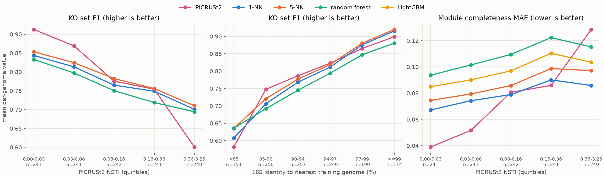
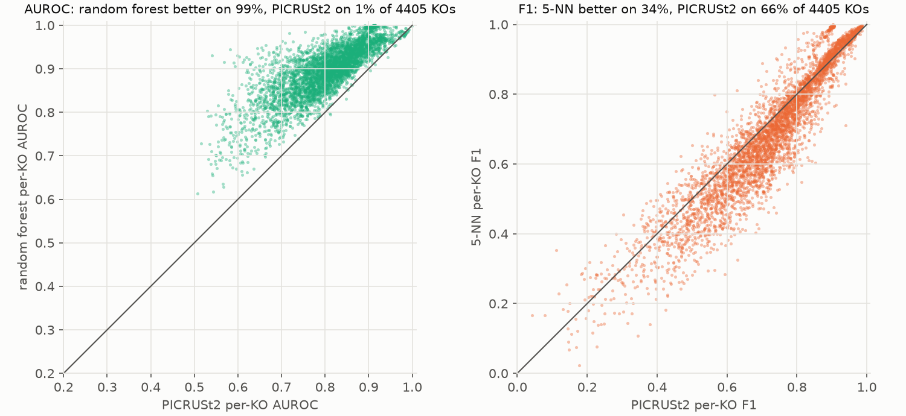
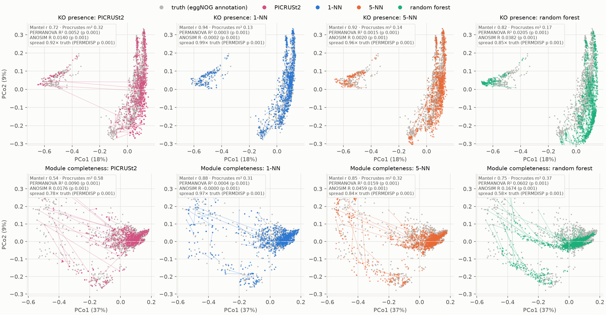

# PICRUSt2 against our 16S models

Same genomes, same targets, per genome. 1999 genomes; **1205 are not in PICRUSt2's reference** (the fair test set) and 794 are (PICRUSt2 then reads the genome's own annotation, a leak). Targets: 4405 KOs (present in 5-95 % of genomes; the Aim 1 set) and 378 KEGG modules. Truth: eggNOG-mapper annotation of each genome.

Our predictions are out-of-fold (full-length 16S, random 5-fold split): each genome is predicted by models trained on the other ~80 % of genomes, never on itself. PICRUSt2 2.6.4 runs with its default reference. PICRUSt2 returned no prediction for 0 genome(s) (NSTI > 2); they count as predicting nothing.

## 1. Does our approach beat PICRUSt2, and by how much?

**KO sets:** our best model (5-NN, mean F1 0.785) is not distinguishable from PICRUSt2 (F1 0.783): difference +0.003 (95 % CI -0.006 to +0.011). Per genome, ours is better on 39% and PICRUSt2 on 61% (ties: the rest): the mean can favour one method while more genomes favour the other, which is why the Wilcoxon p (ranks) and the CI (mean) can disagree.

**Module completeness:** our best model (1-NN, mean error 0.079) is not distinguishable from PICRUSt2 (error 0.077): error lower by -0.002 (95 % CI -0.006 to +0.002).

Mean per-genome scores on the unseen genomes. Precision = share of predicted KOs that are real; recall = share of real KOs that are predicted; `ko_n_predicted` vs `ko_n_true` shows over- or under-prediction.

| metric (mean over unseen genomes) | PICRUSt2 | 1-NN | 5-NN | random forest | LightGBM |
|---|---|---|---|---|---|
| ko_f1 | 0.783 | 0.774 | 0.785 | 0.759 | nan |
| ko_jaccard | 0.671 | 0.646 | 0.660 | 0.622 | nan |
| ko_precision | 0.797 | 0.769 | 0.799 | 0.836 | nan |
| ko_recall | 0.789 | 0.792 | 0.785 | 0.707 | nan |
| module_mae | 0.077 | 0.079 | 0.087 | 0.108 | 0.097 |
| ko_n_predicted | 1096.398 | 1143.692 | 1092.929 | 926.172 | nan |
| ko_n_true | 1106.401 | 1106.401 | 1106.401 | 1106.401 | 1106.401 |

Paired per genome (our model minus PICRUSt2, signed so that **positive = ours better**; module error sign-flipped), bootstrap 95 % CI, Wilcoxon signed-rank p, and the share of genomes where ours is better:

| metric | ours | n | ours_mean | picrust2_mean | diff (ours better > 0) | ci_lo | ci_hi | wilcoxon_p | genomes_ours_better | genomes_picrust2_better |
|---|---|---|---|---|---|---|---|---|---|---|
| ko_f1 | 1-NN | 1205 | 0.774 | 0.783 | -0.008 | -0.017 | -0.000 | 0.000 | 0.333 | 0.667 |
| ko_f1 | 5-NN | 1205 | 0.785 | 0.783 | 0.003 | -0.006 | 0.011 | 0.000 | 0.388 | 0.612 |
| ko_f1 | random forest | 1205 | 0.759 | 0.783 | -0.024 | -0.032 | -0.015 | 0.000 | 0.285 | 0.715 |
| ko_precision | 1-NN | 1205 | 0.769 | 0.797 | -0.028 | -0.038 | -0.018 | 0.000 | 0.241 | 0.759 |
| ko_precision | 5-NN | 1205 | 0.799 | 0.797 | 0.002 | -0.007 | 0.013 | 0.000 | 0.325 | 0.675 |
| ko_precision | random forest | 1205 | 0.836 | 0.797 | 0.040 | 0.030 | 0.049 | 0.000 | 0.561 | 0.439 |
| ko_recall | 1-NN | 1205 | 0.792 | 0.789 | 0.003 | -0.004 | 0.010 | 0.195 | 0.458 | 0.534 |
| ko_recall | 5-NN | 1205 | 0.785 | 0.789 | -0.004 | -0.010 | 0.003 | 0.001 | 0.437 | 0.553 |
| ko_recall | random forest | 1205 | 0.707 | 0.789 | -0.082 | -0.089 | -0.076 | 0.000 | 0.169 | 0.824 |
| module_mae | 1-NN | 1205 | 0.079 | 0.077 | -0.002 | -0.006 | 0.002 | 0.000 | 0.363 | 0.637 |
| module_mae | 5-NN | 1205 | 0.087 | 0.077 | -0.010 | -0.013 | -0.007 | 0.000 | 0.265 | 0.735 |
| module_mae | random forest | 1205 | 0.108 | 0.077 | -0.031 | -0.034 | -0.028 | 0.000 | 0.143 | 0.857 |
| module_mae | LightGBM | 1205 | 0.097 | 0.077 | -0.020 | -0.023 | -0.016 | 0.000 | 0.185 | 0.815 |

For context, the genomes inside PICRUSt2's reference (not a fair test; PICRUSt2 sees their own annotation):

| metric | ours | n | ours_mean | picrust2_mean | diff (ours better > 0) | ci_lo | ci_hi | wilcoxon_p | genomes_ours_better | genomes_picrust2_better |
|---|---|---|---|---|---|---|---|---|---|---|
| ko_f1 | 1-NN | 794 | 0.819 | 0.937 | -0.118 | -0.125 | -0.112 | 0.000 | 0.026 | 0.974 |
| ko_f1 | 5-NN | 794 | 0.826 | 0.937 | -0.111 | -0.117 | -0.105 | 0.000 | 0.033 | 0.967 |
| ko_f1 | random forest | 794 | 0.800 | 0.937 | -0.137 | -0.143 | -0.131 | 0.000 | 0.014 | 0.986 |

**Reference size differs.** In this pilot our models learn from ~1599 genomes per fold; PICRUSt2's reference has 27,870. Accuracy rises with reference density (Aim 1 figure 1), so this comparison handicaps our models; at full scale ours learn from ~44,000.

## 2. Where is either approach better?

> **Figure 1. Accuracy by how novel each genome is**, unseen genomes only. Left and right: genomes binned by PICRUSt2's NSTI (tree distance to its nearest reference genome; quintiles). Middle: binned by 16S identity to our nearest training genome. Each point is the mean per-genome score of one method in that bin.
>
> **How to read it:** where one line sits above (F1) or below (error) the other, that method is better for genomes of that novelty. The two x axes measure novelty against different references, so PICRUSt2's NSTI is the common yardstick for both methods in the left and right panels.

By taxon (unseen genomes; groups with >= 25 genomes): mean KO F1 per method.

| group | n | KO F1 PICRUSt2 | KO F1 1-NN | KO F1 5-NN | KO F1 random forest | best |
|---|---|---|---|---|---|---|
| domain: Bacteria | 1058 | 0.803 | 0.780 | 0.791 | 0.763 | PICRUSt2 |
| phylum: Pseudomonadota | 162 | 0.877 | 0.803 | 0.811 | 0.810 | PICRUSt2 |
| domain: Archaea | 147 | 0.639 | 0.736 | 0.745 | 0.729 | 5-NN |
| phylum: Actinomycetota | 106 | 0.895 | 0.834 | 0.846 | 0.836 | PICRUSt2 |
| phylum: Patescibacteriota | 52 | 0.350 | 0.618 | 0.637 | 0.627 | 5-NN |
| phylum: Bacteroidota | 49 | 0.909 | 0.810 | 0.833 | 0.824 | PICRUSt2 |
| phylum: Bacillota | 43 | 0.907 | 0.816 | 0.828 | 0.778 | PICRUSt2 |
| phylum: Acidobacteriota | 42 | 0.819 | 0.782 | 0.790 | 0.774 | PICRUSt2 |
| phylum: Chloroflexota | 27 | 0.826 | 0.718 | 0.736 | 0.674 | PICRUSt2 |

> **Figure 2. Per-KO ranking quality**, unseen genomes. Each dot is one KO; AUROC measures how well a method's score (PICRUSt2: predicted copy number; ours: probability) ranks genomes that carry the KO above genomes that do not (0.5 = chance, 1 = perfect).
>
> Right: per-KO F1 of the presence calls (PICRUSt2: copy number >= 1; 5-NN: probability >= 0.5).
>
> **How to read it:** dots above the diagonal are KOs our model predicts better; below, PICRUSt2 does. AUROC rewards a graded score: our probabilities are graded, PICRUSt2's copy numbers are coarse (mostly 0, 1, 2), which limits its AUROC. The F1 panel compares the yes/no calls that users read.
>
> **Here:** median per-KO AUROC 0.901 (random forest) vs 0.810 (PICRUSt2); median per-KO F1 0.689 (5-NN) vs 0.734 (PICRUSt2).

KOs where the random forest beats PICRUSt2 most (AUROC):

| ko | name | prevalence | auroc__M2_picrust2 | auroc__M3_rf | auroc__M1_knn5 |
|---|---|---|---|---|---|
| K00948 | PRPS, prsA; ribose-phosphate pyrophosphokinase [EC:2.7.6.1] | 0.920 | 0.540 | 0.931 | 0.871 |
| K00858 | ppnK, NADK; NAD+ kinase [EC:2.7.1.23] | 0.885 | 0.581 | 0.944 | 0.905 |
| K01756 | purB, ADSL; adenylosuccinate lyase [EC:4.3.2.2] | 0.867 | 0.568 | 0.916 | 0.864 |
| K00133 | asd; aspartate-semialdehyde dehydrogenase [EC:1.2.1.11] | 0.827 | 0.599 | 0.930 | 0.911 |
| K00609 | pyrB, PYR2; aspartate carbamoyltransferase catalytic subunit [EC:2.1.3.2] | 0.853 | 0.602 | 0.928 | 0.858 |
| K01951 | guaA, GMPS; GMP synthase (glutamine-hydrolysing) [EC:6.3.5.2] | 0.892 | 0.591 | 0.915 | 0.834 |
| K01591 | pyrF; orotidine-5'-phosphate decarboxylase [EC:4.1.1.23] | 0.864 | 0.594 | 0.905 | 0.832 |
| K01939 | purA, ADSS; adenylosuccinate synthase [EC:6.3.4.4] | 0.880 | 0.614 | 0.922 | 0.892 |
| K00800 | aroA; 3-phosphoshikimate 1-carboxyvinyltransferase [EC:2.5.1.19] | 0.830 | 0.619 | 0.926 | 0.910 |
| K01952 | purL, PFAS; phosphoribosylformylglycinamidine synthase [EC:6.3.5.3] | 0.846 | 0.644 | 0.948 | 0.908 |

KOs where PICRUSt2 beats the random forest most:

| ko | name | prevalence | auroc__M2_picrust2 | auroc__M3_rf | auroc__M1_knn5 |
|---|---|---|---|---|---|
| K02003 | ABC.CD.A; putative ABC transport system ATP-binding protein | 0.936 | 0.813 | 0.795 | 0.730 |
| K12349 | ASAH2; neutral ceramidase [EC:3.5.1.23] | 0.048 | 0.848 | 0.831 | 0.847 |
| K01389 | MME, CD10; neprilysin [EC:3.4.24.11] | 0.037 | 0.943 | 0.927 | 0.917 |
| K00884 | NAGK, nagK; N-acetylglucosamine kinase [EC:2.7.1.59] | 0.059 | 0.811 | 0.798 | 0.784 |
| K10007 | gluD; glutamate transport system permease protein | 0.058 | 0.962 | 0.954 | 0.968 |
| K06518 | cidA; holin-like protein | 0.087 | 0.903 | 0.896 | 0.836 |
| K10006 | gluC; glutamate transport system permease protein | 0.056 | 0.960 | 0.952 | 0.967 |
| K18588 | COQ10; coenzyme Q-binding protein COQ10 | 0.071 | 0.981 | 0.974 | 0.981 |
| K07177 | K07177; Lon-like protease | 0.107 | 0.982 | 0.975 | 0.978 |
| K03185 | ubiH; 2-octaprenyl-6-methoxyphenol hydroxylase [EC:1.14.13.-] | 0.135 | 0.984 | 0.979 | 0.984 |

## 3. Ordination: predicted against true functional profiles

> **Figure 3. Do the predicted profiles reproduce the functional landscape of the genomes?** For each row, the true profiles of the unseen genomes (grey) and every method's predicted profiles for the same genomes are placed in one principal-coordinates analysis (PCoA), so all panels of a row share axes. Top: KO presence/absence, Jaccard distance. Bottom: KEGG module completeness, Bray-Curtis distance. Thin lines join a genome's true profile to its predicted profile (random subset of genomes).
>
> **How to read it:** a good method's coloured cloud overlays the grey cloud and its lines are short. Each panel's box gives two kinds of numbers. *Agreement, genome by genome:* Mantel r = correlation between true and predicted genome-to-genome distances (1 = the method keeps which genomes are functionally alike); Procrustes m² = mismatch after best rotation and scaling of the two 10-axis ordinations (0 = identical). *Group tests, predicted cloud against true cloud:* PERMANOVA R² = share of all variation explained by 'predicted vs true' (0 = clouds share a centre); ANOSIM R = how much farther apart profiles are across the two groups than within (0 = no separation, 1 = complete); spread = mean distance to the group centroid relative to truth (PERMDISP; below 1 = predictions are more alike than real genomes, i.e. pulled towards typical profiles).
>
> Tests use 999 permutations that swap the two labels within each genome, because every genome appears in both groups (paired design). With about a thousand genomes, very small differences reach p = 0.001: read the effect sizes (R², R, spread), not only p. Under these within-genome swaps the null ANOSIM R sits slightly below 0, so an R of about 0 can still give p = 0.001.

Agreement with the truth, genome by genome:

| space | method | genomes | mantel_r (between-genome distances vs truth) | procrustes_m2 (0 = same configuration) | mean distance to own truth |
|---|---|---|---|---|---|
| KO presence (Jaccard) | PICRUSt2 | 1205 | 0.722 | 0.325 | 0.329 |
| KO presence (Jaccard) | 1-NN | 1205 | 0.936 | 0.127 | 0.354 |
| KO presence (Jaccard) | 5-NN | 1205 | 0.915 | 0.143 | 0.340 |
| KO presence (Jaccard) | random forest | 1205 | 0.824 | 0.173 | 0.378 |
| Module completeness (Bray-Curtis) | PICRUSt2 | 1205 | 0.544 | 0.579 | 0.161 |
| Module completeness (Bray-Curtis) | 1-NN | 1205 | 0.884 | 0.309 | 0.162 |
| Module completeness (Bray-Curtis) | 5-NN | 1205 | 0.847 | 0.324 | 0.175 |
| Module completeness (Bray-Curtis) | random forest | 1205 | 0.745 | 0.373 | 0.217 |

Group tests, each method's predicted profiles against the true profiles:

| space | method | PERMANOVA R2 | PERMANOVA p | ANOSIM R | ANOSIM p | spread truth | spread method | PERMDISP p |
|---|---|---|---|---|---|---|---|---|
| KO presence (Jaccard) | PICRUSt2 | 0.0052 | 0.001 | 0.0140 | 0.001 | 0.502 | 0.460 | 0.001 |
| KO presence (Jaccard) | 1-NN | 0.0003 | 0.001 | -0.0002 | 0.001 | 0.502 | 0.499 | 0.001 |
| KO presence (Jaccard) | 5-NN | 0.0015 | 0.001 | 0.0020 | 0.001 | 0.502 | 0.482 | 0.001 |
| KO presence (Jaccard) | random forest | 0.0205 | 0.001 | 0.0382 | 0.001 | 0.502 | 0.425 | 0.001 |
| Module completeness (Bray-Curtis) | PICRUSt2 | 0.0090 | 0.001 | 0.0176 | 0.001 | 0.270 | 0.209 | 0.001 |
| Module completeness (Bray-Curtis) | 1-NN | 0.0004 | 0.001 | -0.0000 | 0.001 | 0.270 | 0.262 | 0.001 |
| Module completeness (Bray-Curtis) | 5-NN | 0.0159 | 0.001 | 0.0459 | 0.001 | 0.270 | 0.226 | 0.001 |
| Module completeness (Bray-Curtis) | random forest | 0.0602 | 0.001 | 0.1674 | 0.001 | 0.270 | 0.157 | 0.001 |

Group tests, our predicted profiles against PICRUSt2's (same genomes):

| space | comparison | genomes | PERMANOVA R2 | PERMANOVA p | ANOSIM R | ANOSIM p | spread PICRUSt2 | spread ours | PERMDISP p |
|---|---|---|---|---|---|---|---|---|---|
| KO presence (Jaccard) | 1-NN vs PICRUSt2 | 1205 | 0.0054 | 0.001 | 0.0160 | 0.001 | 0.460 | 0.499 | 0.001 |
| KO presence (Jaccard) | 5-NN vs PICRUSt2 | 1205 | 0.0023 | 0.001 | 0.0046 | 0.001 | 0.460 | 0.482 | 0.001 |
| KO presence (Jaccard) | random forest vs PICRUSt2 | 1205 | 0.0108 | 0.001 | 0.0162 | 0.001 | 0.460 | 0.425 | 0.001 |
| Module completeness (Bray-Curtis) | 1-NN vs PICRUSt2 | 1205 | 0.0076 | 0.001 | 0.0179 | 0.001 | 0.209 | 0.262 | 0.001 |
| Module completeness (Bray-Curtis) | 5-NN vs PICRUSt2 | 1205 | 0.0274 | 0.001 | 0.0643 | 0.001 | 0.209 | 0.226 | 0.001 |
| Module completeness (Bray-Curtis) | random forest vs PICRUSt2 | 1205 | 0.0915 | 0.001 | 0.1980 | 0.001 | 0.209 | 0.157 | 0.001 |

## 4. How the methods differ

|  | Our approach | PICRUSt2 2.6.4 (default) |
|---|---|---|
| Question answered | Function of one genome (or one ASV) from its 16S | Same per sequence; built mainly to predict community (metagenome) profiles from ASV tables, with 16S copy-number normalisation |
| Reference genomes | GTDB R232 representatives passing CheckM2 >= 90 % / <= 5 % and a full-length 16S (this run: 1999 genomes; each genome predicted from the other ~80 %) | PICRUSt2-SC: GTDB r214 representatives with a high-quality 16S: 26,868 bacteria + 1,002 archaea |
| Function annotation of the reference | eggNOG-mapper 2.1.15, eggNOG DB 5.0.2, pyrodigal genes | eggNOG-mapper 2.1.12, eggNOG DB 5.0.2, Prodigal genes (the same pipeline as our ground truth) |
| 16S processing | SINA alignment to SILVA 144; aligned positions become features | HMMER alignment to the reference MSA; EPA-ng placement into the GTDB-based 16S tree |
| Prediction | k-NN on 16S identity (copy the closest genomes) or learned models (random forest, LightGBM) on alleles | Hidden-state prediction along the tree (castor, maximum parsimony by default) |
| Output per genome | KO presence probability; KEGG module completeness; COG-category composition | KO (and EC, ...) copy numbers; pathways via MinPath for communities |
| Amplicons | One model per primer pair (V4, V3-V4, full length), trained on the in-silico amplicon | Any fragment is placed on the same full-length reference tree |
| Novelty measure | 16S identity to the nearest training genome | NSTI: tree distance to the nearest reference genome; sequences with NSTI > 2 dropped |
| Validation built in | Clade-blocked cross-validation (genus to class held out) | None per run; NSTI as a warning |
| Tunable to a new reference | Yes: rerun on any genome set (e.g. all 55k GTDB R232 genomes) | Yes, with a custom reference package (tree, HMM, trait tables) |

PICRUSt2 facts: Douglas et al. 2020 (Nat Biotechnol 38:685); PICRUSt2-SC reference database (Bioinformatics 2025, btaf269); genome counts read from the installed reference.

## 5. Inspect the outputs

All in the run's results folder (`results/<profile>/`):

- `picrust2_comparison/per_genome.tsv`: one row per genome: taxonomy, in-reference flag, NSTI, our nearest 16S identity, and per method KO F1, precision, recall, TP/FP/FN, module error.
- `picrust2_comparison/ko_calls.tsv.gz`: genome x KO, every pair that is true or predicted by any method: truth, PICRUSt2 copy number, our probabilities.
- `picrust2_comparison/module_calls.tsv.gz`: genome x module completeness: truth and every method.
- `picrust2_comparison/per_ko.tsv`: per KO, with name: prevalence, AUROC and F1 per method.
- `picrust2_comparison/paired.tsv`, `by_novelty.tsv`, `by_taxon.tsv`, `ordination_stats.tsv`, `ordination_vs_picrust2.tsv`, `ordination_coordinates.tsv`: the numbers behind every table and figure.
- `aim1/<arm>_<level>/predictions/<model>_<target>.parquet`: all out-of-fold predictions of our models, every arm and holdout level.
- `picrust2_out/`: PICRUSt2's own outputs (KO copy numbers, NSTI, reference genome list).
- `targets/`: the truth (KO presence, module completeness, COG profiles).

Example genomes, one per NSTI quintile (unseen; TP = true KOs predicted, FP = predicted but absent, FN = present but missed):

| accession | species | NSTI | 16S id. to our nearest | true KOs | PICRUSt2 TP/FP/FN | 5-NN TP/FP/FN | random forest TP/FP/FN |
|---|---|---|---|---|---|---|---|
| GB_GCA_030269125.1 | Streptomyces hygroscopicus_C | 0.020 | 0.992 | 1729 | 1585/76/144 | 1518/134/211 | 1525/139/204 |
| GB_GCA_029547385.1 | MWCZ01 sp029547385 | 0.044 | 0.998 | 1109 | 846/284/263 | 1018/140/91 | 746/167/363 |
| GB_GCA_020849855.1 | JADZFO01 sp020849855 | 0.124 | 0.891 | 1015 | 860/191/155 | 804/134/211 | 556/124/459 |
| GB_GCA_025453605.1 | JALOPZ01 sp025453605 | 0.208 | 0.996 | 789 | 617/178/172 | 715/118/74 | 641/86/148 |
| GB_GCA_020723935.1 | DYHY01 sp020723935 | 2.112 | 0.931 | 410 | 258/172/152 | 292/89/118 | 257/93/153 |

