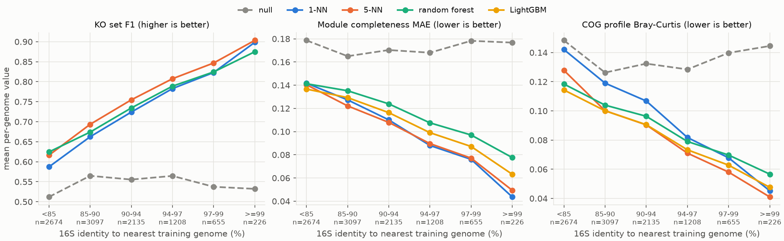
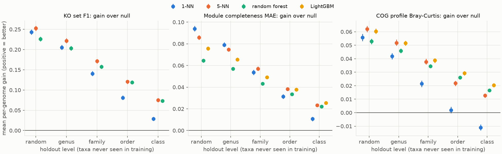
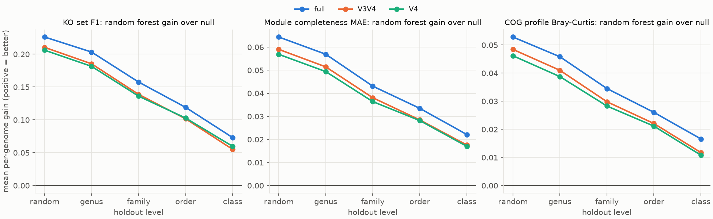
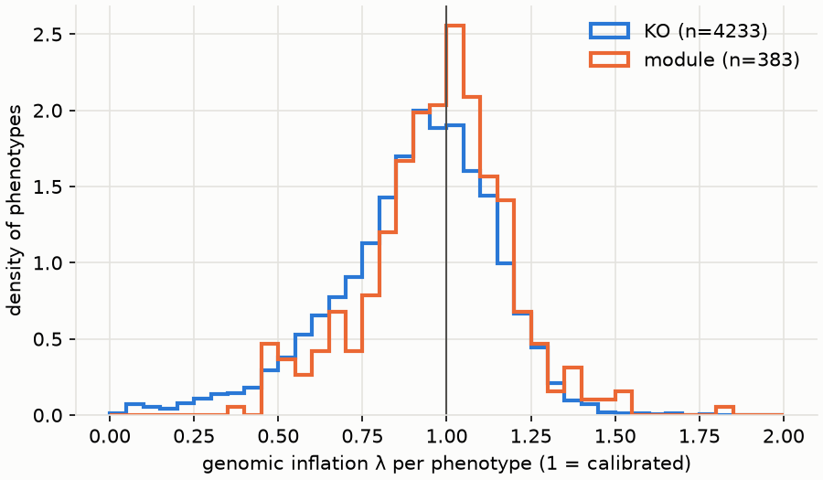
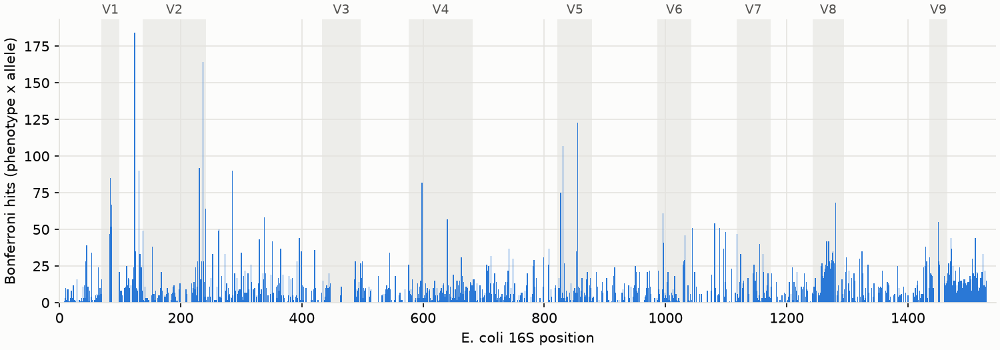
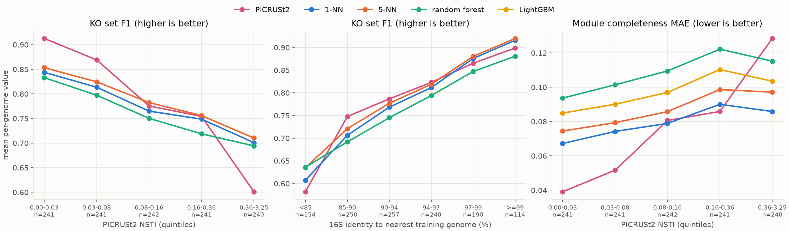
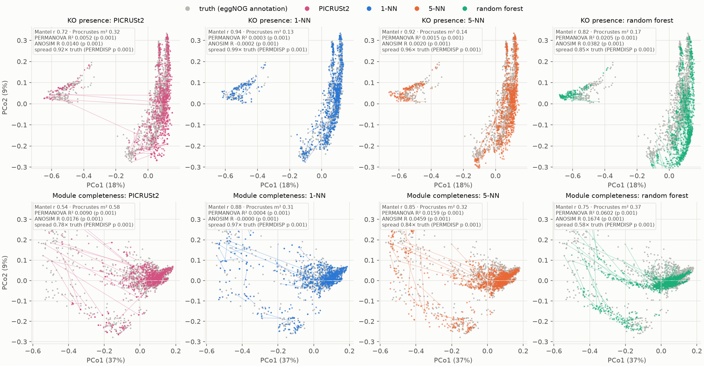

# Pilot report (P4): 2,000 GTDB R232 genomes

Date: 2026-11-06. Run: `./run.sh pilot`, two Nextflow sessions (8 h 46 m launch, plus a 1 h 05 m resume that added
the steps wired in after launch). Machine: 32 cores, 125 GB RAM. Detailed outputs:

- [QC report](qc/qc_report.md) — yield per step
- [Aim 1 report](aim1_report/aim1_report.md) — prediction
- [Aim 2 report](aim2_report/aim2_report.md) — association
- [PICRUSt2 comparison](picrust2_comparison/picrust2_comparison.md) — head-to-head, ordination, all outputs
- [Cost report](cost.md) — CPU and wall time per step

## 1. Engineering

| check | result |
|---|---|
| tasks failed | 0 (100 in run 1, 89 new + 81 cached in the resume) |
| usable genomes | 1,999 / 2,000 (99.95 %; 1 genome without a full-length 16S). Design target ≥ 90 % |
| in-silico PCR success | V4 98.0 %, V3V4 95.9 % (archaea 90.7 % / 77.5 %) |
| disk | `db/` 51 GB (eggNOG 48 GB), `work/pilot` 9.5 GB, `results/pilot` 228 MB |
| peak memory | PICRUSt2 61.5 GB; eggNOG 11.6 GB; ALIGN_16S 10.3 GB; AIM1_PREDICT 7.4 GB; others < 4 GB |

Problems found and fixed during the pilot:

- **BUILD_TARGETS took 2.3 h on one core**, all in `give_completeness` (~4.7 s per genome; ~70 h at 55k).
  Now runs on 16 genome chunks in parallel, output identical to serial (D067).
- The resume re-ran ALIGN_16S and its dependants once, because deep caching was enabled after the pilot was
  launched (the hash mode changed). Not a bug: the test profile resumes with full caching. `cost_report.py` now counts
  each task once (D068).

## 2. Cost extrapolation

Per-genome steps cost **283 CPU-s per genome**, 98 % of it eggNOG-mapper (runs one batch at a time on all cores,
26.5 cores busy on average).

| step | pilot (2k) | 20k genomes | 54,963 genomes |
|---|---|---|---|
| eggNOG (elapsed, serial batches) | 5.8 h | ~58 h | **~160 h (6.7 days)** |
| fetch + barrnap + genes (run alongside eggNOG) | 2.4 CPU-h | ~24 CPU-h | ~66 CPU-h |
| BUILD_TARGETS (after D067) | ~10 min | ~1.5 h | ~4 h |
| Aim 1 (15 arm × level tasks) | 6.6 CPU-h | ~70–150 CPU-h | ~200–400 CPU-h |
| Aim 2 (pyseer LMM, as built) | 8.8 CPU-h | see §6 | **infeasible as built** (see §6) |
| PICRUSt2 | 13 min, 61.5 GB | needs chunking | needs chunking |
| PICRUSt2 comparison | 25 min | ~4 h (linear, not measured) | ~11 h (linear, not measured) |
| disk, `work/` | 9.5 GB | ~95 GB | ~260 GB |

Aim 1 is extrapolated from its parts: the k-NN identity matrix (test × train, per fold) grows with n², and the forest grows
with about n log n. At 55k the largest identity block is ~11k × 44k (2 GB float32), so it fits.

## 3. Aim 1 — can 16S predict function?

**Yes. The signal is phylogenetic, and it fades with distance to the nearest reference.**

- Gain in per-genome KO-set F1 over the null model (training-set prevalence), random forest, full-length 16S:
  random split +0.23, genus holdout +0.20, family +0.16, order +0.12, class +0.07.
  All 95 % CIs exclude 0.
- Median per-KO AUROC, full-length random forest: 0.91 (random) → 0.85 (family) → 0.70 (class).
- Accuracy rises steadily with 16S identity to the nearest training genome (fig 1). KO F1 is ~0.60 below 85 %
  identity and ~0.90 at ≥ 99 %. Tree distance and 16S identity agree (Spearman −0.79).
- **Learned models do not beat 5-NN at this scale.** RF and LightGBM are worse than 5-NN at the random, genus and family
  levels, by 0.01–0.03 in F1 and MAE. At order and class they are equal or slightly better: COG Bray-Curtis +0.004–0.008,
  KO F1 not significant. The 16S works as a phylogenetic placement. Individual positions do not add usable
  information beyond "who is my closest relative" — at least not with 2k genomes.
- **Amplicons cost 9–35 % of the gain.** RF KO F1 gain is 0.226 / 0.210 / 0.206 (full / V3V4 / V4) at the random level,
  and 0.073 / 0.055 / 0.060 at class. V3V4 and V4 are indistinguishable.
- **PICRUSt2 ties with 5-NN when it is fair** (§5). On the 1,205 genomes not in PICRUSt2's own reference, its KO F1
  is 0.783; ours on the same genomes: 5-NN 0.785, 1-NN 0.774. On the 794 genomes in its reference it scores 0.94,
  which is leakage, not skill.
- Note: the null model's median per-KO AUROC is below 0.5 (0.38–0.47). The null predicts one constant per fold; when a
  held-out clade carries a KO, the training prevalence is lower. Pooled over folds, that anti-correlates. The null's
  per-genome scores, used for "gain over null", are unaffected.

> **Accuracy against 16S similarity to the closest training genome.** Each test genome is binned by the full-length
> 16S identity to its most similar training genome. Lines are models; the dashed grey line is the null, which ignores
> the 16S. Panels: KO set F1 (higher is better), module completeness error and COG profile dissimilarity (lower is better).
>
> **Takeaway:** every model improves steadily as the closest reference gets closer, and the models stay close to each
> other. The 16S predicts function through its nearest relatives; learned models do not escape that dependence.

> **Gain over the null as test genomes become more distant.** Left to right, whole genera, families, orders and
> classes are kept out of training. Points are mean gain over the null with 95 % CIs; above 0 means the 16S helps.
>
> **Takeaway:** the gain shrinks with distance but stays above 0 for KOs and modules even for unseen classes. 1-NN
> (blue) drops fastest; averaging 5 neighbours or learning (forest, LightGBM) holds up better far from the reference.

> **Full-length 16S against the V4 and V3-V4 amplicons** (random forest, gain over the null).
>
> **Takeaway:** the amplicons keep most of the signal; they lose a roughly constant amount at every level, which is a
> larger share of the small gain at order and class. V4 and V3-V4 are nearly identical.

## 4. Aim 2 — 16S alleles associated with function beyond phylogeny

1,795 bacteria, 3,252 alleles (3,106 unique patterns), 4,616 phenotypes (4,233 KOs, 383 modules), pyseer LMM with
GTDB-tree kinship.

- **Calibration is good.** Median genomic inflation λ is 0.94 (KOs) and 0.99 (modules), with 10–90 % range 0.6–1.2.
- **The positive control works.** Reverse gyrase (K03170, hyperthermophily) has 187 Bonferroni hits, including the top
  12 overall. Its positively associated alleles are 74 % G/C, against 47 % background: the known GC–thermostability
  relation of rRNA stems, recovered without being told.
- 11,591 Bonferroni hits (2,518 phenotypes, 2,272 alleles); 20,801 at BH-FDR < 0.05. 10.7 % of tests were flagged by
  pyseer and excluded.
- **The homoplasy filter does not discriminate.** All 2,272 hit alleles change more than once on the tree (Fitch).
  At 1,795 genomes almost every allele is homoplasic, so "> 1 change" separates nothing. Many hits are likely still
  clade-tagging that the kinship term absorbs only partly. A stricter criterion is needed before reading individual hits
  as biology (§7, question 3).

> **Calibration of the association test.** One λ per phenotype; λ = 1 means the phylogenetic correction removes the
> inflation caused by shared ancestry, above 1 means leftover structure (false positives), below 1 means conservative.
>
> **Takeaway:** both distributions centre on 1 (65 % of KOs between 0.8 and 1.2), so the test is not inflated by
> ancestry. The KO tail below 0.5 means a conservative test for those KOs: less power, not false positives.

> **Where the significant alleles sit along the 16S** (*E. coli* numbering; grey bands = variable regions V1-V9).
>
> **Takeaway:** hits spread along the whole gene and are not enriched in variable regions (43 % of hits, against 48 %
> of tested alleles). The highest peaks sit near position 125 (conserved stretch between V1 and V2), at the end of V2
> (~235) and in V5 (~830-860). Positions with very many hits mark clades rather than single functions, which is why the
> homoplasy criterion (§7, question 3) matters.

## 5. PICRUSt2 head-to-head

Full report: [PICRUSt2 comparison](picrust2_comparison/picrust2_comparison.md). Fair test set: the **1,205 genomes
not in PICRUSt2's reference** (same GTDB accession = in; 794 are). Our predictions are out-of-fold (full-length 16S,
random split), so no genome is ever predicted from itself.

**Q1. Does our approach beat PICRUSt2? Overall, no: it ties.**

| per genome, mean (unseen genomes) | PICRUSt2 | ours, best | ours − PICRUSt2 (95 % CI) | genomes where ours is better |
|---|---|---|---|---|
| KO F1 | 0.783 | 0.785 (5-NN) | +0.003 (−0.006 to +0.011) | 39 % |
| module completeness error | 0.077 | 0.079 (1-NN) | +0.002 worse (−0.002 to +0.006) | 36 % |

The random forest is worse overall (KO F1 −0.024), but it is more precise: 0.836 against 0.797. It calls fewer KOs,
and more of them are right. The tie comes with a handicap for us: each fold learns from ~1,600 genomes; PICRUSt2's
reference has 27,870. At full scale ours learn from ~44,000.

**Q2. Is our approach better anywhere? Yes, in three places.**

1. **Novel genomes.** In the most novel fifth (NSTI > 0.36), KO F1 is 0.71 (5-NN) against 0.60 (PICRUSt2), and module
   error 0.086 (1-NN) against 0.128. PICRUSt2 wins clearly for genomes close to its reference (NSTI < 0.03: F1 0.91 vs
   0.85; module error 0.039 vs 0.067). The lines cross in the middle quintile, NSTI 0.08–0.16 (figure below).
2. **Clades poorly covered by PICRUSt2.** Archaea: 0.745 vs 0.639. Patescibacteriota (CPR): 0.637 vs 0.350.
   PICRUSt2 is better in every well-sampled bacterial phylum (Pseudomonadota 0.877 vs 0.811, Actinomycetota,
   Bacteroidota, Bacillota, Acidobacteriota, Chloroflexota).
3. **Ranking genomes per KO, and the shape of the functional landscape.** Per-KO AUROC: random forest higher on
   99 % of 4,405 KOs (median 0.90 vs 0.81). PICRUSt2's copy numbers are coarse (0, 1, 2), so it ranks genomes poorly,
   worst for core genes carried by ~90 % of genomes. Between-genome functional distances correlate with the truth at
   Mantel r 0.94 (1-NN) against 0.72 (PICRUSt2) for KOs, and 0.88 against 0.54 for modules (Q4).

Where PICRUSt2 is better: per-KO F1 of the presence calls (better on 66 % of KOs against 5-NN), and anything close
to its reference.

> **Accuracy by novelty**, unseen genomes. Left and right: genomes binned by PICRUSt2's NSTI (tree distance to its
> nearest reference genome; quintiles). Middle: binned by 16S identity to our nearest training genome. Each point is
> one method's mean per-genome score in that bin; pink = PICRUSt2.
>
> **Takeaway:** PICRUSt2 is the better tool for genomes close to its reference. It loses accuracy faster with novelty,
> and in the most novel fifth our models are ahead on both KOs and modules.

**Q3. Where is the output?** Small tables, figures and the report: `reports/pilot/picrust2_comparison/`. Everything,
including the large call tables: `results/pilot/picrust2_comparison/`:

- `per_genome.tsv`: one row per genome (taxonomy, in-reference flag, NSTI, our nearest 16S identity, per-method KO
  F1/precision/recall/TP/FP/FN and module error).
- `ko_calls.tsv.gz` (results only): genome × KO, truth, PICRUSt2 copy number and our probabilities.
- `module_calls.tsv.gz` (results only): genome × module completeness, truth and every method.
- `per_ko.tsv`: per KO, with name: prevalence, AUROC and F1 per method.
- `results/pilot/aim1/<arm>_<level>/predictions/*.parquet`: all out-of-fold predictions of our models.
- `results/pilot/picrust2_out/`: PICRUSt2's own outputs (KO copy numbers, NSTI, reference genome list).

**Q4. Ordination of predicted against true profiles.**

> **Predicted against true functional profiles in one ordination.** Per row, the true profiles of the 1,205 unseen
> genomes (grey) and each method's predictions for the same genomes share one PCoA. Top: KO presence (Jaccard).
> Bottom: module completeness (Bray–Curtis). Thin lines join a genome's true and predicted profile.
>
> **Numbers in each panel:** Mantel r (do predicted genome-to-genome distances follow the true ones; 1 = yes),
> Procrustes m² (shape mismatch; 0 = same), PERMANOVA R² (share of variation explained by predicted vs true; 0 = same
> centre), ANOSIM R (separation of the two clouds; 0 = none) and spread = PERMDISP (distance to centroid; below truth
> = predictions pulled towards typical profiles). 999 permutations swap labels within each genome (paired design).
>
> **Takeaway:** all methods sit on top of the truth: PERMANOVA R² ≤ 0.02 for KOs and ≤ 0.06 for modules. With 1,205
> paired genomes, every test reaches p = 0.001, so the effect sizes are what matter. 1-NN reproduces the landscape best
> (Mantel 0.94; R² 0.0003; spread 0.50 vs 0.50 in the truth). PICRUSt2 keeps the centre (R² 0.005) but scrambles which
> genomes are alike (Mantel 0.72). The random forest shrinks profiles most (module spread 0.16 vs 0.27; ANOSIM R 0.17).

| KO presence (Jaccard) | Mantel r | PERMANOVA R² | ANOSIM R | spread (truth 0.502) |
|---|---|---|---|---|
| PICRUSt2 | 0.72 | 0.0052 | 0.014 | 0.460 |
| 1-NN | 0.94 | 0.0003 | −0.000 | 0.499 |
| 5-NN | 0.92 | 0.0015 | 0.002 | 0.482 |
| random forest | 0.82 | 0.0205 | 0.038 | 0.425 |

| module completeness (Bray–Curtis) | Mantel r | PERMANOVA R² | ANOSIM R | spread (truth 0.270) |
|---|---|---|---|---|
| PICRUSt2 | 0.54 | 0.0090 | 0.018 | 0.209 |
| 1-NN | 0.88 | 0.0004 | −0.000 | 0.262 |
| 5-NN | 0.85 | 0.0159 | 0.046 | 0.226 |
| random forest | 0.75 | 0.0602 | 0.167 | 0.157 |

All p = 0.001 (PERMANOVA, ANOSIM and PERMDISP). The report also tests ours against PICRUSt2 directly.

**Q5. How the methods differ.**

| | ours | PICRUSt2 2.6.4 (default) |
|---|---|---|
| reference | GTDB R232, CheckM2 ≥ 90 % / ≤ 5 %; pilot ~1,600 per fold, full ~44,000 | PICRUSt2-SC: GTDB r214, 27,870 genomes |
| reference annotation | eggNOG-mapper 2.1.15, DB 5.0.2 | eggNOG-mapper 2.1.12, DB 5.0.2 (same pipeline as our truth) |
| 16S processing | SINA alignment (SILVA 144); positions as features | HMMER + EPA-ng placement into a 16S tree |
| prediction | k-NN on 16S identity; random forest / LightGBM on alleles | hidden-state prediction on the tree (maximum parsimony) |
| output | KO probability, module completeness, COG composition | KO copy number; pathways via MinPath |
| amplicons | one model per primer pair | any fragment placed on the full-length tree |
| novelty measure | 16S identity to nearest training genome | NSTI; NSTI > 2 dropped |
| built-in validation | clade-blocked CV, genus to class | none; NSTI as a warning |

**Caveat.** PICRUSt2 can be given a custom reference. Running it with our training folds as its reference would remove
the reference-size difference and leave only the method difference. That is an option for the full run (§7).

## 6. What must change before full scale

1. **Aim 2 cannot run at 52k bacteria as built.** Each phenotype runs pyseer separately. Each run re-reads an
   n × n kinship (≈ 30 GB as text at 52k) and re-decomposes it (O(n³)). Even with pyseer's `--save-lmm` / `--load-lmm`
   (decompose once), each phenotype costs O(n² × variants): about 1 CPU-h per phenotype at 52k, or ~4,600 CPU-h in total.
   Options: run Aim 2 on a stratified subsample (~15k bacteria: ~5 min per phenotype, ~12 h on 32 cores), plus
   `--save-lmm`.
2. **PICRUSt2 used 61.5 GB for 2k queries.** Its placement step should run in chunks (sequences are independent),
   e.g. 2k per task. The comparison step (§5) should run on the same chunks.
3. **Patristic distances** use a dense n × n matrix (D063). At 55k that is 12 GB, and the kinship it is built from is
   larger still. It needs a nearest-relative-on-tree computation instead of all pairs.

None of these touches the per-genome steps, which take most of the time.

## 7. Open decisions for the full run

1. **Scale.** All 54,963 filtered genomes: ~7 days of eggNOG, ~260 GB of work disk. Or a stratified 20k subset:
   ~2.5 days. The case for 55k is that Aim 1 accuracy depends on reference density (fig 1). The full set is also
   the only way to test whether learned models beat k-NN when data is plentiful.
2. **Aim 2 sample** (§6.1): stratified subsample of about 15k bacteria, or another size.
3. **Aim 2 homoplasy criterion** (§4). Options: require ≥ 5 independent origins of the allele, or require the association
   to replicate within ≥ 2 independent orders (test within clades).
4. **PICRUSt2 with our reference.** Optionally rerun PICRUSt2 with a custom reference built from our training folds,
   to compare methods on an equal reference (§5, caveat). Cost: one reference build and one placement per fold.
5. Still open from the design: D048 (fixed hyperparameters, no inner CV), D060 (GC-enrichment control instead of a
   stem map), and D019 (Aim 2 bacteria only; the pilot has 204 archaea).
