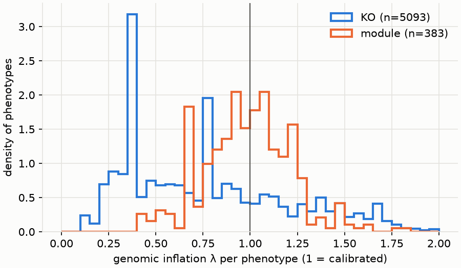
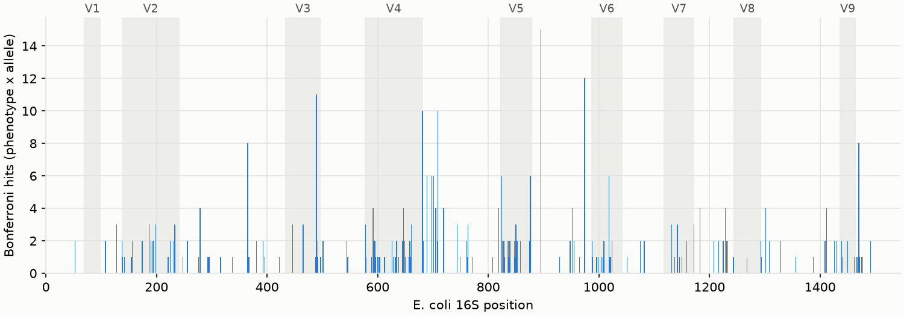

# Aim 2 report: 16S alleles associated with function beyond phylogeny

Genomes: 20 (bacteria). Variants tested: 2123 (1070 unique patterns; Bonferroni threshold p < 4.67e-05). Phenotypes: 5093 KOs, 383 modules.

Each test asks whether genomes that carry one 16S allele (a nucleotide at an aligned position) more often carry a function, after accounting for shared ancestry. Tool: pyseer linear mixed model; kinship from the GTDB bacterial tree. One test per phenotype × allele.

## Calibration

> **Figure 1. Is the association test calibrated?** For each phenotype (a KO's presence, or a module's completeness), the genomic inflation factor λ compares the median association statistic over all tested alleles with its expectation when nothing is associated. The curves are normalised to the same area, so KOs and modules can be compared despite different counts.
>
> **How to read it:** λ ≈ 1 means the phylogenetic correction (the linear mixed model with GTDB-tree kinship) removes the inflation that shared ancestry causes; λ well above 1 would mean leftover population structure and false positives; λ below 1 means the test is conservative for that phenotype (less power, not false positives).
>
> **Here:** median λ is 0.72 for KOs; 20% of KOs have λ between 0.8 and 1.2.

| kind | count | 10% | 50% | 90% |
|---|---|---|---|---|
| KO | 5093 | 0.324 | 0.724 | 1.45 |
| module | 383 | 0.68 | 0.986 | 1.25 |

## Significant associations

Bonferroni hits (phenotype × allele): **388** across 126 phenotypes and 220 alleles. BH-FDR < 0.05 (unflagged): 826. Tests flagged by pyseer (`notes`, e.g. bad-chisq / high-bse) are never hits: 95.0% of all tests.

Alleles among hits that arose more than once on the tree (Fitch changes > 1): **204 of 220**. Only these can support association beyond phylogeny.

> **Figure 2. Where on the 16S the significant alleles sit.** Each bar counts Bonferroni-significant phenotype × allele pairs at one alignment position, in *E. coli* 16S numbering. Grey bands mark the nine variable regions V1-V9; the unshaded stretches are conserved regions.
>
> **How to read it:** tall bars are positions whose alleles track many functions at once. That is typical of alleles that mark a clade, whose members share many genes: a hotspot is not by itself evidence of a functional link. Peaks in conserved regions are more surprising than peaks in variable regions.
>
> **Here:** 50% of hits fall in variable regions, which hold 55% of tested alleles.

Top 30 hits. `variant` = alignment column_state; `ecoli_pos` = E. coli position; `af` = allele frequency; `beta` = effect (positive: the allele goes with more of the function); `fitch_changes` = minimum number of times the allele arose or was lost on the tree.

| phenotype | variant | ecoli_pos | state | af | beta | p | fitch_changes |
|---|---|---|---|---|---|---|---|
| M00993 | 852_26802_G | 852 | G | 0.15 | 0.5 | 0 | 3 |
| M00993 | 834_26161_C | 834 | C | 0.15 | 0.5 | 0 | 3 |
| M00128 | 698_21917_T | 698 | T | 0.1 | 0.125 | 0 | 2 |
| M00128 | 689_21786_A | 689 | A | 0.1 | 0.125 | 0 | 2 |
| M00128 | 974_31158_C | 974 | C | 0.1 | 0.125 | 0 | 2 |
| M00883 | 578_15646_G | 578 | G | 0.1 | -0.333 | 0 | 2 |
| M00883 | 465_9992_G | 465 | G | 0.1 | -0.333 | 0 | 2 |
| M00883 | 763_22539_C | 763 | C | 0.1 | -0.333 | 0 | 2 |
| M00085 | 233_5272_C | 233 | C | 0.8 | -0.333 | 5.07e-144 | 2 |
| M00085 | 128_2062_G | 128 | G | 0.8 | -0.333 | 5.07e-144 | 2 |
| M00128 | 974_31158_A | 974 | A | 0.9 | -0.125 | 2.11e-142 | 2 |
| M00744 | 719_21995_T | 719 | T | 0.1 | 0.667 | 5.98e-140 | 1 |
| M00744 | 705_21929_T | 705 | T | 0.9 | -0.667 | 5.98e-140 | 1 |
| M00744 | 719_21995_C | 719 | C | 0.9 | -0.667 | 5.98e-140 | 1 |
| M00744 | 948_29668_T | 948 | T | 0.1 | 0.667 | 5.98e-140 | 1 |
| M00744 | 1233_40274_A | 1233 | A | 0.1 | 0.667 | 5.98e-140 | 1 |
| M00744 | 705_21929_G | 705 | G | 0.1 | 0.667 | 5.98e-140 | 1 |
| M00157 | 1024_32538_T | 1024 | T | 0.1 | -0.988 | 5.32e-20 | 2 |
| M00157 | 592_15692_C | 592 | C | 0.1 | -0.988 | 5.32e-20 | 2 |
| M00157 | 232_5270_C | 232 | C | 0.1 | -0.988 | 5.32e-20 | 2 |
| M00051 | 1470_43028_G | 1470 | G | 0.9 | 0.63 | 1.7e-18 | 2 |
| M00051 | 489_10262_T | 489 | T | 0.1 | -0.63 | 1.7e-18 | 2 |
| M00149 | 895_27165_G | 895 | G | 0.75 | 0.781 | 4.65e-11 | 4 |
| M00919 | 1172_37683_T | 1172 | T | 0.1 | 0.388 | 1.46e-10 | 2 |
| M00378 | 612_15963_C | 612 | C | 0.85 | -0.516 | 3.3e-10 | 3 |
| M00378 | 628_16292_G | 628 | G | 0.85 | -0.516 | 3.3e-10 | 3 |
| M00810 | 193_4075_G | 193 | G | 0.15 | 0.127 | 4.31e-10 | 3 |
| M00642 | 719_21995_T | 719 | T | 0.1 | 0.621 | 4.65e-10 | 1 |
| M00642 | 705_21929_T | 705 | T | 0.9 | -0.621 | 4.65e-10 | 1 |
| M00642 | 719_21995_C | 719 | C | 0.9 | -0.621 | 4.65e-10 | 1 |

## Controls

Positive control: reverse gyrase (K03170) is found almost only in hyperthermophiles, whose rRNA is G/C-rich to stabilise its stems at high temperature. If the method works, alleles positively associated with K03170 should be G or C more often than tested alleles in general.

_no control phenotype present in >= 5 genomes_

Positive control expectation: reverse gyrase (K03170) hits with beta > 0 are G/C-enriched relative to the background allele composition.

Files: `per_phenotype.tsv`, `hits_bonferroni.tsv`.
